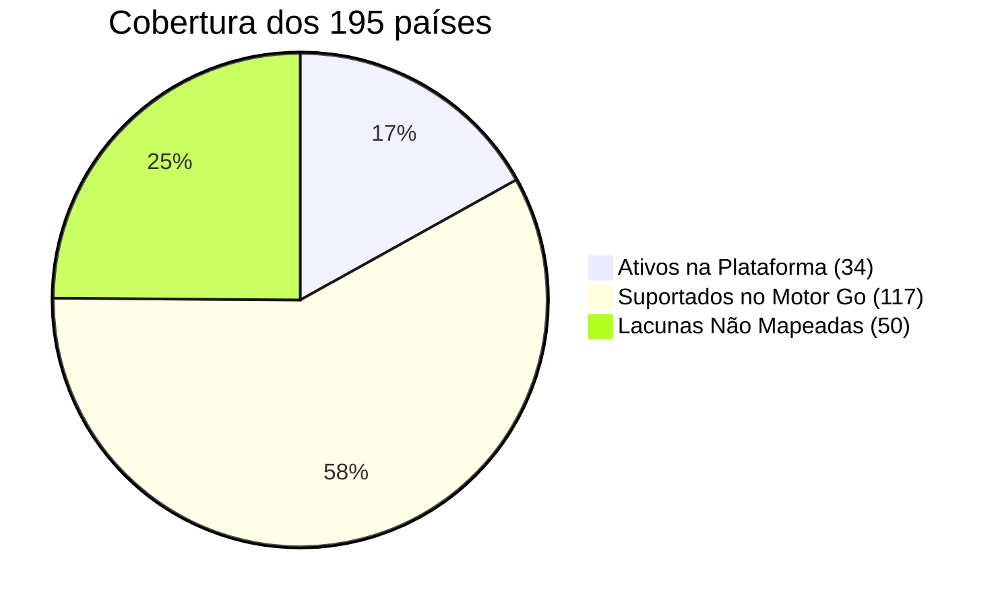

# Catálogo de Países por Continente (Modelo dos 7 Continentes)

Base: **195 países** = 193 membros da ONU + Vaticano + Palestina.
Legenda: 
- ✅ **Suportado com Preset no Go** (`presets.go`)
- 🚀 **Ativo na Plataforma (34 Presets Integrados no Workflow e Frontend)**
- ❌ **Lacuna** (preset ainda não mapeado)

> [!NOTE]
> **Status da Release v3.4.0+:** O catálogo do Commit Rank conta atualmente com **34 destinos plenamente ativos** configurados no pipeline automatizado de 8 lotes rotativos (`.github/workflows/update-rankings.yml`) e mapeados no seletor web (`index.html`).

---

## Resumo de Cobertura

| Continente / Grupo | Países Oficiais | 🚀 Ativos no Pipeline (34) | ✅ Suportados em `presets.go` | ❌ Lacunas |
| :--- | :---: | :---: | :---: | :---: |
| 🌐 Global (Worldwide) | — | **1** | **1** | — |
| 🌍 África | 54 | **5** (`mozambique`, `angola`, `nigeria`, `south-africa`, `kenya`) | 40 | 14 |
| 🌎 América do Norte & Caribe | 23 | **5** (`united-states`, `canada`, `mexico`, `the-bahamas`, `panama`) | 13 | 10 |
| 🌎 América do Sul | 12 | **5** (`brazil`, `argentina`, `colombia`, `venezuela`, `uruguay`) | 11 | 1 |
| 🌍 Europa | 44 | **5** (`portugal`, `germany`, `france`, `netherlands`, `russia`) | 37 | 7 |
| 🌏 Ásia | 48 | **5** (`china`, `india`, `japan`, `south-korea`, `saudi-arabia`) | 41 | 7 |
| 🌏 Oceânia | 14 | **3** (`australia`, `new-zealand`, `papua-new-guinea`) | 3 | 11 |
| 🌐 Territórios & Regiões Especiais | — | **5** (`hong-kong`, `macau`, `taiwan`, `kosovo`, `kurdistan`) | 5 | — |
| **Total Global Ativo** | **195** | **34 destinos ativos** | **151** | **50** |

---

## Rotação Automatizada de 8 Lotes no GitHub Actions

O workflow `.github/workflows/update-rankings.yml` executa diariamente um ciclo de 8 dias para atualização equilibrada dos datasets:

| Lote | Frequência | Presets Extraídos |
| :--- | :--- | :--- |
| **Batch 0** | Dia 0 (`% 8 == 0`) | `worldwide`, `united-states` |
| **Batch 1** | Dia 1 (`% 8 == 1`) | `worldwide`, `brazil` |
| **Batch 2** | Dia 2 (`% 8 == 2`) | `mozambique`, `angola`, `nigeria`, `south-africa`, `kenya` |
| **Batch 3** | Dia 3 (`% 8 == 3`) | `canada`, `mexico`, `the-bahamas`, `panama` |
| **Batch 4** | Dia 4 (`% 8 == 4`) | `argentina`, `colombia`, `venezuela`, `uruguay` |
| **Batch 5** | Dia 5 (`% 8 == 5`) | `hong-kong`, `macau`, `taiwan`, `kosovo`, `kurdistan` |
| **Batch 6** | Dia 6 (`% 8 == 6`) | `portugal`, `germany`, `france`, `netherlands`, `russia` |
| **Batch 7** | Dia 7 (`% 8 == 7`) | `china`, `india`, `japan`, `south-korea`, `saudi-arabia`, `australia`, `new-zealand`, `papua-new-guinea` |

---

## 1. 🌍 África (54)

| País | Preset | País | Preset |
| :--- | :---: | :--- | :---: |
| Algeria | ✅ | Libya | ✅ |
| Angola | ✅ | Madagascar | ✅ |
| Benin | ✅ | Malawi | ✅ |
| Botswana | ✅ | Mali | ✅ |
| Burkina Faso | ✅ | Mauritania | ✅ |
| Burundi | ✅ | Mauritius | ✅ |
| **Cabo Verde** | ❌ | Morocco | ✅ |
| Cameroon | ✅ | Mozambique | ✅ |
| **Central African Republic** | ❌ | **Namibia** | ❌ |
| Chad | ✅ | Niger | ✅ |
| **Comoros** | ❌ | Nigeria | ✅ |
| DR Congo | ✅ | Rwanda | ✅ |
| Republic of the Congo | ✅ | **São Tomé and Príncipe** | ❌ |
| **Djibouti** | ❌ | Senegal | ✅ |
| Egypt | ✅ | **Seychelles** | ❌ |
| **Equatorial Guinea** | ❌ | Sierra Leone | ✅ |
| **Eritrea** | ❌ | Somalia | ✅ |
| **Eswatini** | ❌ | South Africa | ✅ |
| Ethiopia | ✅ | South Sudan | ✅ |
| Gabon | ✅ | Sudan | ✅ |
| **Gambia** | ❌ | Tanzania | ✅ |
| Ghana | ✅ | Togo | ✅ |
| Guinea | ✅ | Tunisia | ✅ |
| **Guinea-Bissau** | ❌ | Uganda | ✅ |
| Ivory Coast | ✅ | Zambia | ✅ |
| Kenya | ✅ | Zimbabwe | ✅ |
| **Lesotho** | ❌ | **Liberia** | ❌ |

**Lacunas (14):** Cabo Verde, República Centro-Africana, Comores, Djibouti, Guiné Equatorial, Eritreia, Eswatini, Gâmbia, Guiné-Bissau, Lesoto, Libéria, Namíbia, São Tomé e Príncipe, Seicheles.

> [!IMPORTANT]
> Cabo Verde e São Tomé e Príncipe são lusófonos. Cabo Verde já aparece no frontend, mas **não** tem preset no backend. Guiné-Bissau também é lusófona.

---

## 2. 🌏 Ásia (48)

| País | Preset | País | Preset |
| :--- | :---: | :--- | :---: |
| Afghanistan | ✅ | Oman | ✅ |
| Armenia | ✅ | Pakistan | ✅ |
| Azerbaijan | ✅ | Palestine | ✅ |
| Bahrain | ✅ | Philippines | ✅ |
| Bangladesh | ✅ | Qatar | ✅ |
| **Bhutan** | ❌ | Saudi Arabia | ✅ |
| **Brunei** | ❌ | Singapore | ✅ |
| Cambodia | ✅ | South Korea | ✅ |
| China | ✅ | Sri Lanka | ✅ |
| Cyprus | ✅ | Syria | ✅ |
| Georgia | ✅ | Tajikistan | ✅ |
| India | ✅ | Thailand | ✅ |
| Indonesia | ✅ | **Timor-Leste** | ❌ |
| Iran | ✅ | Turkey | ✅ |
| Iraq | ✅ | Turkmenistan | ✅ |
| Israel | ✅ | UAE | ✅ |
| Japan | ✅ | Uzbekistan | ✅ |
| Jordan | ✅ | Vietnam | ✅ |
| Kazakhstan | ✅ | Yemen | ✅ |
| **Kuwait** | ❌ | Kyrgyzstan | ✅ |
| Laos | ✅ | Lebanon | ✅ |
| Malaysia | ✅ | **Maldives** | ❌ |
| **Mongolia** | ❌ | Myanmar | ✅ |
| Nepal | ✅ | **North Korea** | ❌ |

**Lacunas (7):** Butão, Brunei, Kuwait, Maldivas, Mongólia, Coreia do Norte, Timor-Leste.

> [!NOTE]
> Convenção usada: Turquia, Chipre, Geórgia, Arménia e Azerbaijão ficam na Ásia; Rússia fica na Europa.

---

## 3. 🌍 Europa (44)

| País | Preset | País | Preset |
| :--- | :---: | :--- | :---: |
| Albania | ✅ | Netherlands | ✅ |
| **Andorra** | ❌ | North Macedonia | ✅ |
| Austria | ✅ | Norway | ✅ |
| Belarus | ✅ | Poland | ✅ |
| Belgium | ✅ | Portugal | ✅ |
| Bosnia and Herzegovina | ✅ | Romania | ✅ |
| Bulgaria | ✅ | Russia | ✅ |
| Croatia | ✅ | **San Marino** | ❌ |
| Czech Republic | ✅ | Serbia | ✅ |
| Denmark | ✅ | Slovakia | ✅ |
| Estonia | ✅ | Slovenia | ✅ |
| Finland | ✅ | Spain | ✅ |
| France | ✅ | Sweden | ✅ |
| Germany | ✅ | Switzerland | ✅ |
| Greece | ✅ | Ukraine | ✅ |
| Hungary | ✅ | United Kingdom | ✅ |
| **Iceland** | ❌ | **Vatican City** | ❌ |
| Ireland | ✅ | Latvia | ✅ |
| Italy | ✅ | Lithuania | ✅ |
| **Liechtenstein** | ❌ | Luxembourg | ✅ |
| Malta | ✅ | Moldova | ✅ |
| **Monaco** | ❌ | **Montenegro** | ❌ |

**Lacunas (7):** Andorra, Islândia, Listenstaine, Mónaco, Montenegro, San Marino, Vaticano.

---

## 4. 🌎 América do Norte (23) — inclui América Central e Caribe

| País | Preset | País | Preset |
| :--- | :---: | :--- | :---: |
| **Antigua and Barbuda** | ❌ | Haiti | ✅ |
| The Bahamas | ✅ | Honduras | ✅ |
| **Barbados** | ❌ | **Jamaica** | ❌ |
| **Belize** | ❌ | Mexico | ✅ |
| Canada | ✅ | Nicaragua | ✅ |
| Costa Rica | ✅ | Panama | ✅ |
| Cuba | ✅ | **Saint Kitts and Nevis** | ❌ |
| **Dominica** | ❌ | **Saint Lucia** | ❌ |
| Dominican Republic | ✅ | **Saint Vincent and the Grenadines** | ❌ |
| El Salvador | ✅ | **Trinidad and Tobago** | ❌ |
| **Grenada** | ❌ | United States | ✅ |
| Guatemala | ✅ | | |

**Lacunas (10):** Antígua e Barbuda, Barbados, Belize, Dominica, Granada, Jamaica, São Cristóvão e Nevis, Santa Lúcia, São Vicente e Granadinas, Trinidad e Tobago.

---

## 5. 🌎 América do Sul (12)

| País | Preset | País | Preset |
| :--- | :---: | :--- | :---: |
| Argentina | ✅ | Peru | ✅ |
| Bolivia | ✅ | Suriname | ✅ |
| Brazil | ✅ | Uruguay | ✅ |
| Chile | ✅ | Venezuela | ✅ |
| Colombia | ✅ | **Guyana** | ❌ |
| Ecuador | ✅ | Paraguay | ✅ |

**Lacuna (1):** Guiana.

---

## 6. 🌏 Oceânia (14)

| País | Preset | País | Preset |
| :--- | :---: | :--- | :---: |
| Australia | ✅ | **Palau** | ❌ |
| **Fiji** | ❌ | Papua New Guinea | ✅ |
| **Kiribati** | ❌ | **Samoa** | ❌ |
| **Marshall Islands** | ❌ | **Solomon Islands** | ❌ |
| **Micronesia** | ❌ | **Tonga** | ❌ |
| **Nauru** | ❌ | **Tuvalu** | ❌ |
| New Zealand | ✅ | **Vanuatu** | ❌ |

**Lacunas (11):** Fiji, Quiribáti, Ilhas Marshall, Micronésia, Nauru, Palau, Samoa, Ilhas Salomão, Tonga, Tuvalu, Vanuatu.

---

## 7. 🧊 Antártida (0)

Sem países nem população permanente. Não precisa de preset.

---

## 8. Entidades extra (não fazem parte dos 195)

Existem no `presets.go` mas **não** são contadas no modelo de 195. É aqui que está a decisão de organização:

| Entidade | Preset | Natureza | Sugestão |
| :--- | :---: | :--- | :--- |
| Hong Kong | ✅ | Região Administrativa Especial da China | Agrupar em "Territórios", dentro de Ásia |
| Macau | ✅ | Região Administrativa Especial da China | Agrupar em "Territórios", dentro de Ásia |
| Taiwan | ✅ | Estatuto político disputado | Agrupar em "Territórios", dentro de Ásia |
| Kosovo | ✅ | Reconhecimento parcial | Agrupar em "Territórios", dentro de Europa |
| Kurdistan | ✅ | Região autónoma/cultural (Médio Oriente) | Agrupar em "Regiões", dentro de Ásia |
| Worldwide | ✅ | Agregado global, sem geografia | Destacar à parte, fora dos continentes |

Nota: Palestina **conta** nos 195 (Ásia) e já tem preset.

---

## 9. Pontos para decidir

1. **Preencher as 50 lacunas?** Cada uma precisa de lista de cidades e variantes de nome no `presets.go`. As lusófonas (Cabo Verde, Guiné-Bissau, São Tomé e Príncipe, Timor-Leste) são as mais relevantes para o projeto.
2. **Onde pôr as 6 entidades extra?** Opções: dentro do continente com um selo "Território/Região", ou numa secção própria "Territórios & Regiões".
3. **Taiwan e Kosovo:** são sensíveis politicamente. Como o projeto se quer neutro, a rotulagem como "Território/Região" evita tomar posição.
4. **Países com nomes ambíguos** (Georgia, Guinea, Niger/Nigeria, Dominica/Dominican Republic) precisam de cuidado nas queries de localização para não misturar resultados.
5. **Ordem no frontend:** filtro por continente com contagens `África 54 · Ásia 48 · Europa 44 · América do Norte 23 · América do Sul 12 · Oceânia 14`.
